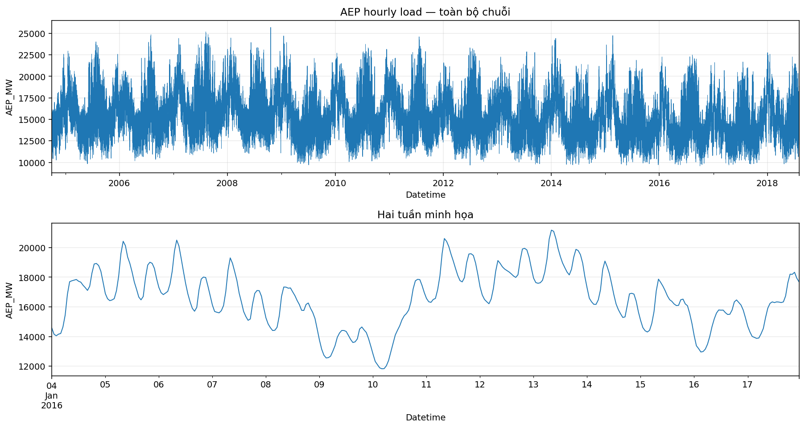
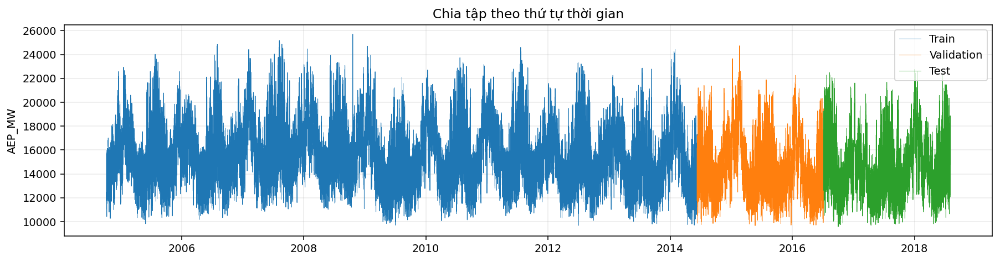
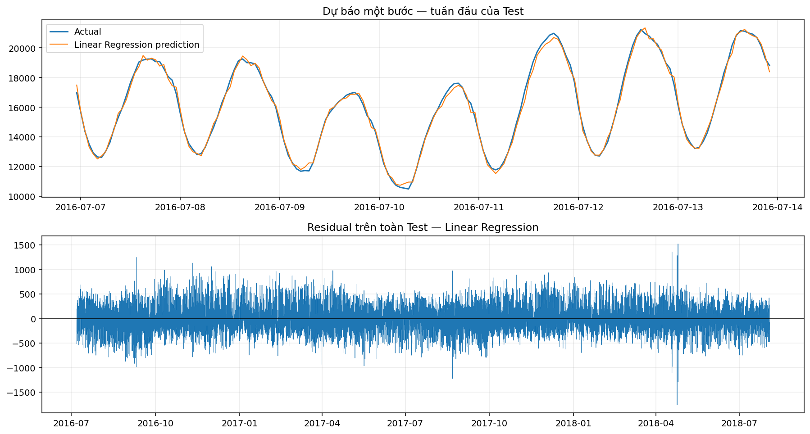
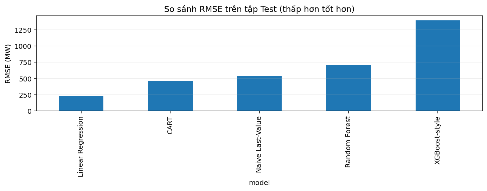
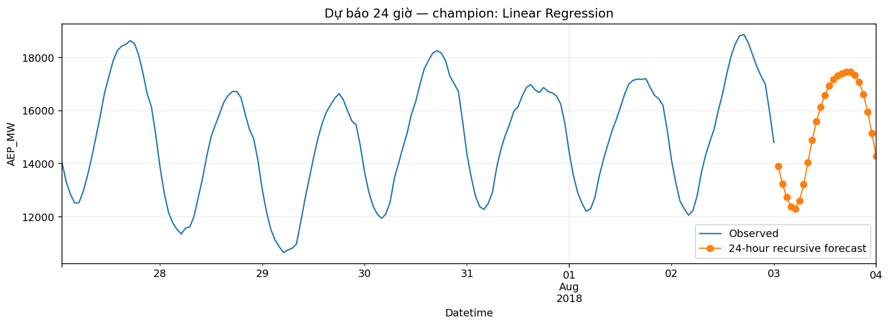
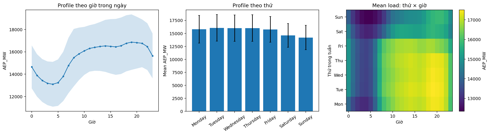
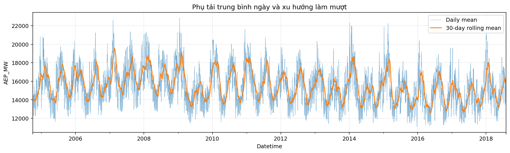
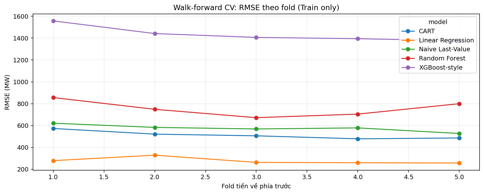
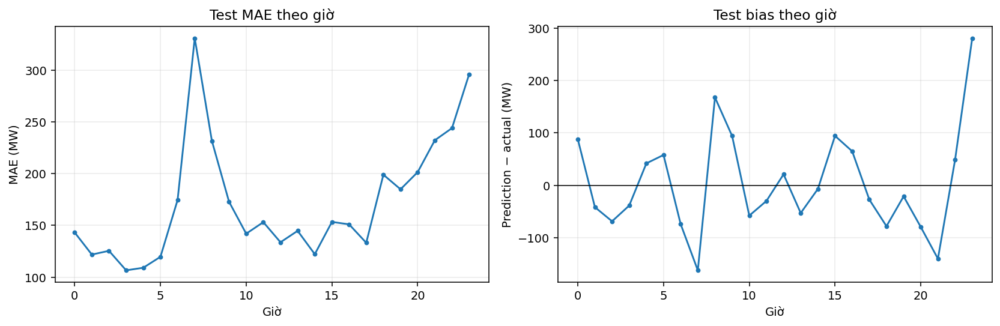
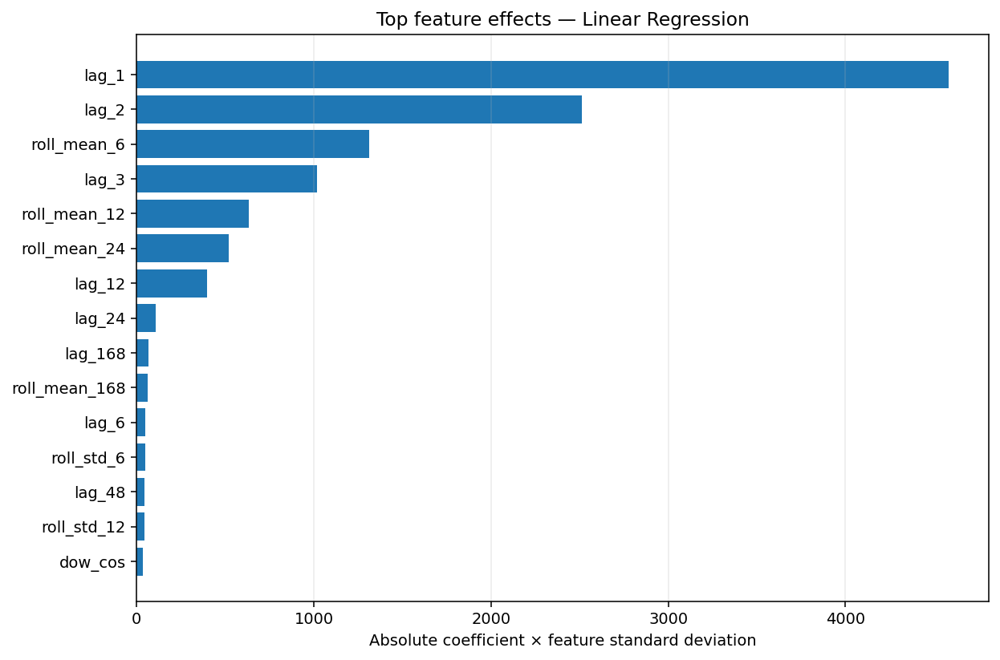

# Lab 03 - Time Series Forecasting Report

**Run ID:** `20261125_050808`  
**Dataset:** `AEP_hourly.csv` (`real_source`)  
**Selected model:** **Linear Regression** (selected by Validation RMSE)  
**Run status:** `SUCCESS`

> **Important:** Test metrics are reported only after model selection. The Test features are rolling one-step-ahead features, so actual observations from earlier test timestamps are available to form later lag features. This is not the same as a fixed-origin 24-hour forecast.

## 1. Executive summary

On AEP_hourly.csv, 121,296 cleaned hourly observations were used. Linear Regression was selected using Validation RMSE (246.14 MW). Its held-out Test RMSE was 228.49 MW. A recursive 24-hour forecast was generated.

## 2. Dataset and data quality

- Source path: `C:\Users\Bin\Documents\Lab_TimeSeries\data\raw\AEP_hourly.csv`
- Dataset type: **real_source**
- Observations after cleaning: **121,296**
- Time span: **2004-10-01 01:00:00** to **2018-08-03 00:00:00**
- Frequency: **h**
- Duplicate timestamps removed: **4**
- Missing periods inserted: **27**
- Missing values remaining after cleaning: **0**

## 3. Preprocessing and chronological split

Feature rows are ordered by timestamp. Train/Validation/Test are contiguous chronological partitions with no shuffle.
| Partition | Rows | Start | End | Target ratio |
|---|---|---|---|---|
| Train | 84,789 | 2004-10-08 01:00:00 | 2014-06-10 21:00:00 | 70% |
| Validation | 18,169 | 2014-06-10 22:00:00 | 2016-07-06 22:00:00 | 15% |
| Test | 18,170 | 2016-07-06 23:00:00 | 2018-08-03 00:00:00 | 15% |

### Feature engineering

- Lag features: `[1, 2, 3, 6, 12, 24, 48, 168]`
- Rolling windows: `[6, 12, 24, 168]`; rolling calculations are shifted by one timestamp before aggregation.
- Calendar features: `True`
- Total feature count: **22**

## 4. Walk-forward cross-validation

Expanding-window CV uses **5 folds** inside the Train partition only. Each fold trains on an earlier block and validates on the following block. Validation and Test partitions are not included in CV.

| Model | Mean RMSE | Std RMSE | Mean MAE | Mean R² |
|---|---|---|---|---|
| Naive Last-Value | 575.926 | 33.729 | 441.614 | 0.950 |
| Linear Regression | 277.589 | 29.939 | 199.313 | 0.988 |
| CART | 513.221 | 37.486 | 405.312 | 0.960 |
| Random Forest | 756.342 | 73.556 | 583.523 | 0.913 |
| XGBoost-style | 1,435.365 | 72.273 | 1,129.681 | 0.690 |

## 5. Model comparison

| Model | CV RMSE mean | Validation RMSE | Test MAE | Test RMSE | Test MAPE (%) | Test R² | Fit s |
|---|---|---|---|---|---|---|---|
| Naive Last-Value | 575.926 | 534.446 | 417.325 | 534.753 | 2.853 | 0.954 | 0.00 |
| Linear Regression | 277.589 | 246.137 | 171.907 | 228.494 | 1.170 | 0.992 | 0.08 |
| CART | 513.221 | 466.009 | 375.121 | 465.906 | 2.558 | 0.965 | 0.61 |
| Random Forest | 756.342 | 755.079 | 557.222 | 705.227 | 3.900 | 0.920 | 0.44 |
| XGBoost-style | 1,435.365 | 1,458.039 | 1,135.129 | 1,396.239 | 8.191 | 0.684 | 0.25 |

### Model selection protocol

1. Candidate algorithms are trained on Train and compared on Validation.
2. The champion is selected by the lowest Validation RMSE; Test is not used to select the champion.
3. Each candidate is refitted on Train + Validation, then evaluated once on the held-out Test partition.
4. Tree-based models may cap their internal training rows to a deterministic evenly spaced subset for runtime. The actual number of rows used is recorded in `model_summary.csv`.

## 6. Inference phase

The champion selected by Validation was refitted on 121128 labeled observations through 2018-08-03 00:00:00 after Test evaluation, then used for **24 recursive hourly steps**. Every predicted value is appended to history and is used to build the next lag/rolling row. No future ground truth is used for this future forecast. This is separate from the Train + Validation fit used for Test scoring.

## 7. Legacy notebook experiment snapshot (separate experiment)

The archived notebook contains a prior experiment using the library implementations of scikit-learn and XGBoost. Its values are preserved for provenance only; they are not current results from the NumPy scratch models and should not be compared as a controlled, apples-to-apples benchmark.

Legacy snapshot file is archived separately in `reports/lab03/legacy/`.

## 8. Figures

### Hourly Series

### Temporal Split

### Test And Residuals

### Test Model Comparison

### Future 24H Forecast

### Temporal Profiles

### Daily Trend

### Walk Forward Cv

### Test Error Profiles

### Feature Effects

## 9. Evaluation metrics

- **MAE:** average absolute error, in target units; lower is better.
- **MSE:** average squared error; penalizes large errors more strongly.
- **RMSE:** square root of MSE, in target units; lower is better.
- **MAPE:** average absolute percentage error over non-zero actual values; unsuitable when actual values are zero or close to zero.
- **sMAPE:** symmetric percentage error using |actual| + |prediction| in the denominator.
- **R²:** proportion of target variance explained relative to a mean baseline; can be negative on out-of-sample data.

## 10. Reproducibility and limitations

- Re-run from the repository root by opening `notebooks/lab03/Lab03_TimeSeries.ipynb` and choosing Run All.
- Place the original `AEP_hourly.csv` in `data/raw/` with columns `Datetime` and `AEP_MW` for the real-data experiment.
- If the AEP file is absent, the pipeline can run a clearly labelled synthetic smoke test; its scores are not AEP findings.
- Linear Regression, CART, Random Forest and the XGBoost-style booster are implemented in this project with NumPy; no scikit-learn or XGBoost estimators/metrics are called by the new pipeline.
- The booster is an educational second-order gradient-boosted-tree implementation with histogram split candidates, not the official XGBoost library.
- The standalone CART uses a quantile candidate-threshold approximation to limit runtime; it is not exhaustive threshold search.
- The Test evaluation is rolling one-step ahead. Multi-step free-running prediction is represented separately by the recursive future inference output.
