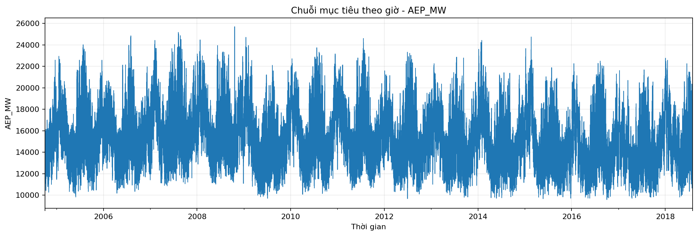
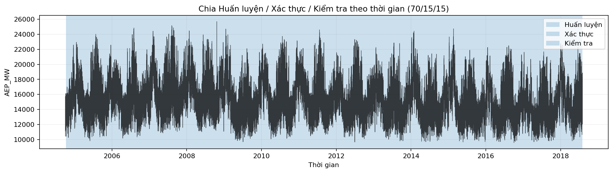
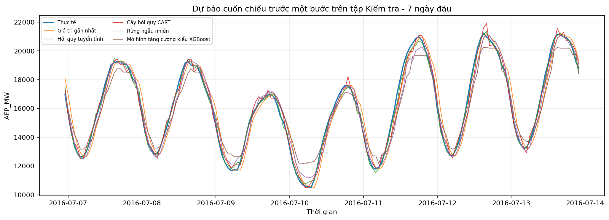
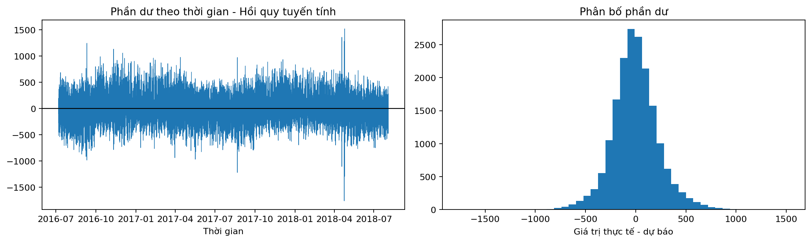
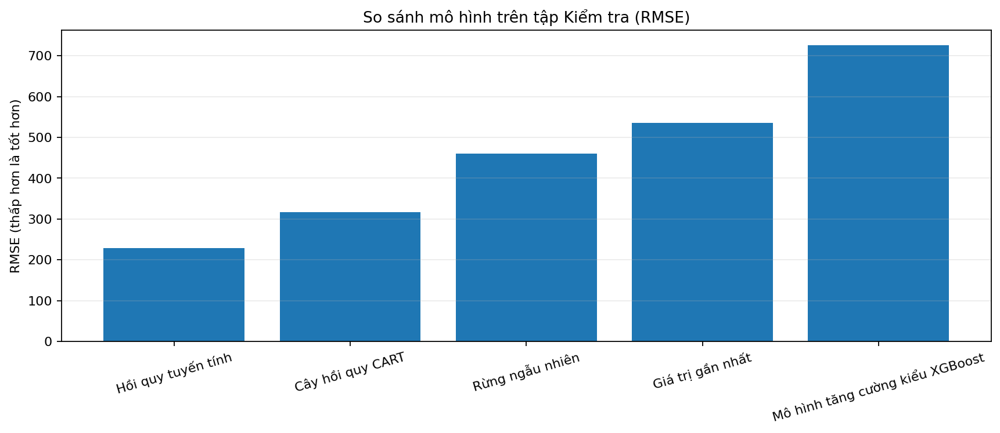
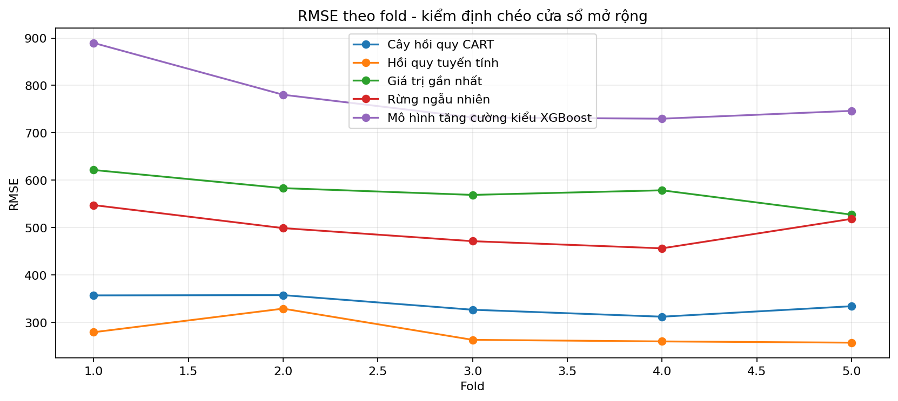
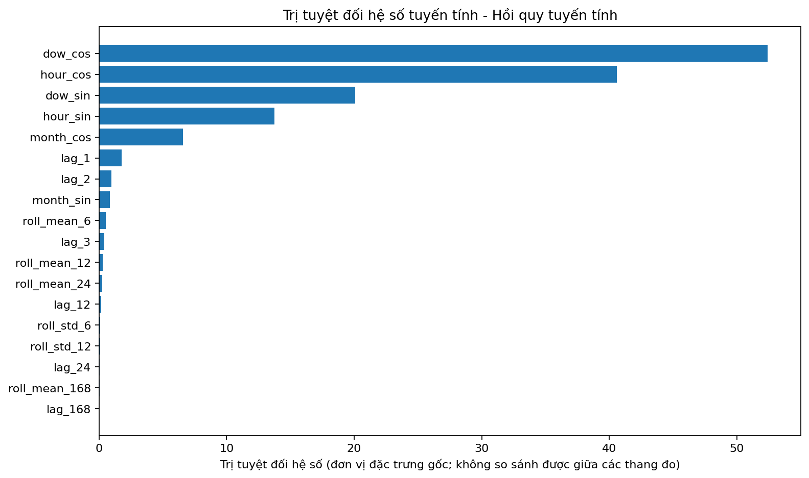
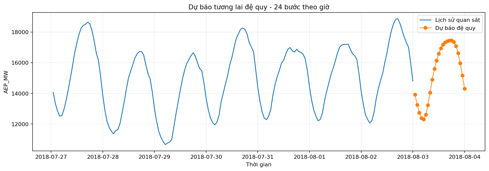
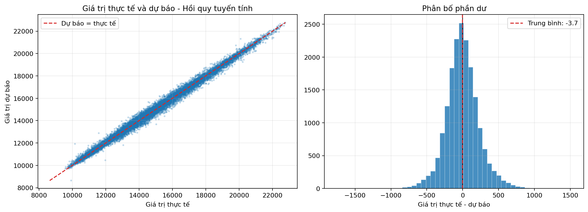
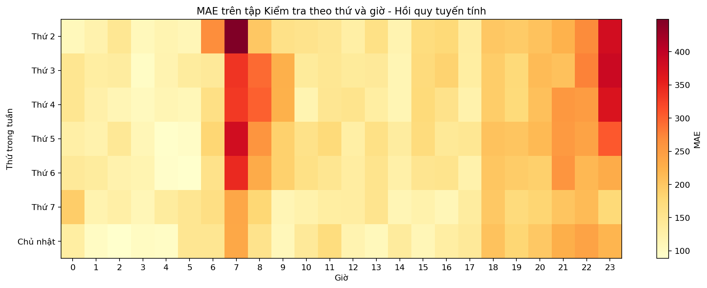

# Báo cáo dự báo chuỗi thời gian — Lab 03

**Mã lần chạy:** `report_fix_20261127`  
**Bộ dữ liệu:** `AEP_hourly.csv` (**dữ liệu thật**)  
**Mô hình được chọn:** **Hồi quy tuyến tính** (theo RMSE trên tập xác thực)  
**Trạng thái lần chạy:** **Hoàn tất**

> **Lưu ý:** Chỉ tính chỉ số trên tập kiểm tra sau khi đã chọn mô hình. Đặc trưng ở tập kiểm tra dùng giao thức dự báo cuốn chiếu trước một bước; giá trị thực tế ở các thời điểm kiểm tra trước đó có thể được dùng để tạo độ trễ cho thời điểm tiếp theo. Giao thức này khác với dự báo 24 giờ từ một mốc cố định.

## 1. Tóm tắt kết quả

Lab 03 huấn luyện 5 mô hình tự cài đặt trên dữ liệu AEP_hourly thật. Mô hình được chọn theo RMSE xác thực thấp nhất là **Hồi quy tuyến tính** (RMSE xác thực=246.14, RMSE kiểm tra=228.49).

## 2. Dữ liệu và chất lượng dữ liệu

- Đường dẫn nguồn: `C:\Users\Bin\Documents\Lab_TimeSeries\data\raw\AEP_hourly.csv`
- Loại dữ liệu: **dữ liệu thật**
- Số quan sát sau làm sạch: **121,296**
- Khoảng thời gian: **2004-10-01 01:00:00** đến **2018-08-03 00:00:00**
- Tần suất: **h**
- Số mốc thời gian trùng đã loại: **4**
- Số khoảng thời gian thiếu đã bổ sung: **27**
- Số giá trị thiếu còn lại sau làm sạch: **0**

## 3. Tiền xử lý và chia dữ liệu theo thời gian

Các dòng đặc trưng được sắp theo mốc thời gian. Tập huấn luyện, tập xác thực và tập kiểm tra là các đoạn thời gian liên tiếp, không xáo trộn.
| Tập dữ liệu | Số dòng | Bắt đầu | Kết thúc | Tỷ lệ mục tiêu |
|---|---|---|---|---|
| Huấn luyện | 84,789 | 2004-10-08 01:00:00 | 2014-06-10 21:00:00 | 70% |
| Xác thực | 18,169 | 2014-06-10 22:00:00 | 2016-07-06 22:00:00 | 15% |
| Kiểm tra | 18,170 | 2016-07-06 23:00:00 | 2018-08-03 00:00:00 | 15% |

### Tạo đặc trưng

- Đặc trưng độ trễ: `[1, 2, 3, 6, 12, 24, 48, 168]`
- Cửa sổ trượt: `[6, 12, 24, 168]`; phép tính được dịch một mốc thời gian trước khi tổng hợp.
- Đặc trưng lịch: Có
- Tổng số đặc trưng: **22**

## 4. Kiểm định chéo cuốn chiếu theo thời gian

Kiểm định chéo cửa sổ mở rộng sử dụng **5 lượt chia** chỉ trong tập huấn luyện. Mỗi lượt huấn luyện trên đoạn trước và xác thực trên đoạn kế tiếp. Tập xác thực và tập kiểm tra bên ngoài không tham gia kiểm định chéo.

| Mô hình | RMSE trung bình | Độ lệch chuẩn RMSE | MAE trung bình | R² trung bình |
|---|---|---|---|---|
| Cây hồi quy CART | 337.364 | 19.742 | 254.786 | 0.983 |
| Hồi quy tuyến tính | 277.589 | 29.939 | 199.313 | 0.988 |
| Giá trị gần nhất | 575.926 | 33.729 | 441.614 | 0.950 |
| Rừng ngẫu nhiên | 498.419 | 36.476 | 379.359 | 0.963 |
| Mô hình tăng cường kiểu XGBoost | 775.685 | 66.806 | 585.731 | 0.909 |

## 5. So sánh mô hình

| Mô hình | RMSE CV trung bình | RMSE xác thực | MAE kiểm tra | RMSE kiểm tra | MAPE kiểm tra (%) | R² kiểm tra | Thời gian khớp (giây) |
|---|---|---|---|---|---|---|---|
| Giá trị gần nhất | 575.926 | 534.446 | 417.325 | 534.753 | 2.853 | 0.954 | 0.00 |
| Hồi quy tuyến tính | 277.589 | 246.137 | 171.907 | 228.494 | 1.170 | 0.992 | 0.05 |
| Cây hồi quy CART | 337.364 | 322.511 | 244.089 | 316.215 | 1.656 | 0.984 | 4.91 |
| Rừng ngẫu nhiên | 498.419 | 493.904 | 365.590 | 460.137 | 2.532 | 0.966 | 8.04 |
| Mô hình tăng cường kiểu XGBoost | 775.685 | 777.448 | 576.028 | 726.126 | 4.152 | 0.915 | 0.65 |

### Quy trình chọn mô hình

1. Các thuật toán ứng viên được huấn luyện trên tập huấn luyện và so sánh trên tập xác thực.
2. Mô hình tốt nhất được chọn theo RMSE xác thực thấp nhất; không dùng tập kiểm tra để chọn mô hình.
3. Mỗi ứng viên được khớp lại trên tập huấn luyện + tập xác thực, sau đó đánh giá một lần trên tập kiểm tra được giữ riêng.
4. Để giảm thời gian chạy, mô hình dạng cây có thể giới hạn số dòng huấn luyện bằng cách chọn đều các dòng theo thời gian. Số dòng thực tế được ghi trong `model_summary.csv`.

## 6. Giai đoạn suy luận

Sau khi đánh giá tập kiểm tra, mô hình tốt nhất theo tập xác thực được khớp lại trên 121,128 quan sát có nhãn đến 2018-08-03 00:00:00, rồi dùng để **dự báo đệ quy 24 giờ**. Mỗi giá trị dự báo được nối vào lịch sử để tạo độ trễ/cửa sổ trượt cho bước tiếp theo. Không sử dụng giá trị thực tương lai. Đây là mô hình riêng với mô hình khớp trên tập huấn luyện + tập xác thực để chấm điểm tập kiểm tra.

## 7. Kết quả thí nghiệm notebook lưu trữ (thí nghiệm riêng)

Notebook lưu trữ có một thí nghiệm trước đây dùng các thư viện scikit-learn và XGBoost. Các giá trị được giữ lại để truy xuất nguồn gốc; đây không phải kết quả hiện tại từ mô hình NumPy tự cài đặt và không nên xem là phép so sánh đối chứng tương đương.

Kết quả lưu trữ được ghi riêng tại `reports/lab03/legacy/`.

## 8. Biểu đồ

### Chuỗi tải điện theo giờ

### Chia dữ liệu theo thời gian

### Dự báo cuốn chiếu trên tập kiểm tra

### Chẩn đoán phần dư

### So sánh mô hình

### Kiểm định chéo cuốn chiếu

### Mức quan trọng của đặc trưng

### Dự báo tương lai đệ quy

### Giá trị thực tế và dự báo

### MAE theo thứ trong tuần và giờ

## 9. Các chỉ số đánh giá

- **MAE:** sai số tuyệt đối trung bình theo đơn vị của biến mục tiêu; càng thấp càng tốt.
- **MSE:** sai số bình phương trung bình; phạt sai số lớn mạnh hơn.
- **RMSE:** căn bậc hai của MSE, cùng đơn vị với biến mục tiêu; càng thấp càng tốt.
- **MAPE:** sai số phần trăm tuyệt đối trung bình trên các giá trị thực khác 0; không phù hợp khi giá trị thực bằng hoặc gần 0.
- **sMAPE:** sai số phần trăm đối xứng, dùng |giá trị thực| + |giá trị dự báo| làm mẫu số.
- **R²:** tỷ lệ biến thiên của biến mục tiêu được giải thích so với mốc dự báo trung bình; có thể âm trên dữ liệu ngoài mẫu.

## 10. Khả năng tái lập và giới hạn

- Để chạy lại, mở `notebooks/lab03/Lab03_Visual_Exploration.ipynb` từ thư mục gốc của kho mã và chạy lần lượt tất cả ô lệnh.
- Đặt tệp gốc `AEP_hourly.csv` trong `data/raw/`, gồm các cột `Datetime` và `AEP_MW`, để chạy thí nghiệm trên dữ liệu thật.
- Nếu thiếu tệp AEP, chỉ chạy kiểm tra nhanh với dữ liệu tổng hợp khi được ghi nhãn rõ ràng; điểm số đó không phải kết quả trên AEP.
- Linear Regression, CART, Random Forest và bộ tăng cường kiểu XGBoost được cài đặt bằng NumPy; pipeline mới không gọi estimator/chỉ số của scikit-learn hoặc XGBoost.
- Bộ tăng cường là bản cài đặt phục vụ học tập của cây tăng cường gradient bậc hai với các ngưỡng chia dạng histogram, không phải thư viện XGBoost chính thức.
- CART độc lập dùng xấp xỉ ngưỡng ứng viên theo phân vị để giới hạn thời gian; không tìm kiếm toàn bộ ngưỡng có thể.
- Đánh giá trên tập kiểm tra là dự báo cuốn chiếu trước một bước. Dự báo tự hồi quy nhiều bước được trình bày riêng trong kết quả suy luận tương lai.
